

# 🚦 깜빡이리그 BlinkerLeague

**회전할 때 깜빡이를 제때 켰는지, 운행마다 판정해 경기처럼 점수 · 퀘스트 · 리그로 돌려주는 차량 앱**

현대자동차 **Pleos** 공모전 출품작 · Android Automotive OS · Pleos Vehicle SDK

---

## 🎬 시연 영상

https://github.com/user-attachments/assets/bfae97f6-cdd4-4e20-8e54-924bc175e837

> 좌회전 깜빡이 성공 → 우회전 깜빡이 누락 → 운행 종료 → 경기 결과 · 퀘스트 · 업적 화면 (Pleos Connect 에뮬레이터)

## 💡 무엇을 하나요

방향지시등은 가장 기본적인 안전 습관이지만, 스스로 얼마나 잘 켜는지 알 방법이 없습니다.
깜빡이리그는 차량 신호로 **운행 한 번을 한 경기**로 보고, 회전마다 깜빡이를 켰는지 판정해 결과를 돌려줍니다.

| | |
| --- | --- |
| 🚗 **운행 자동 기록** | 기어가 D · R · N이 되면 시작, P단 3분이면 종료. 앱이 화면에 없어도 포그라운드 서비스로 기록 |
| ↩️ **회전 · 깜빡이 판정** | 핸들 각도로 회전을 찾고, 회전 시작 5초 전부터 같은 방향 깜빡이를 켰는지 판정 |
| 🏆 **경기 결과** | 정차 후 평점 · 등급, 득점(켠 회전) · 실점(안 켠 회전), 플레이 타임라인, 항목별 판정 근거 |
| 🎯 **퀘스트 · 보상** | 오늘의 퀘스트, 연속 달성 · 배지, 포인트 지갑, 주간 리포트와 다음 주 맞춤 미션 |
| 🗺️ **지역 리그** | 시군구 기반 권역 리그(달력 월 시즌), 권역 순위와 지역 안전지수 |

### 주행 안전 원칙

- 주행 중에는 점수 화면을 띄우지 않고 **"기록 중"** 화면만 보여줍니다. 상세 화면은 정차 · 기어 P에서만 열립니다.
- 음성은 **시동 때 퀘스트 안내 1회, 운행 종료 때 결과 1회**뿐입니다.
- '빨리 도착'처럼 위험한 운전을 부추기는 미션은 만들지 않습니다.
- 원시 위치 좌표는 서버로 보내지 않고, **기기에서 판정한 이벤트만** 보냅니다.

## 📱 화면

| 홈 | 경기 결과 | 플레이 타임라인 |
| --- | --- | --- |
| 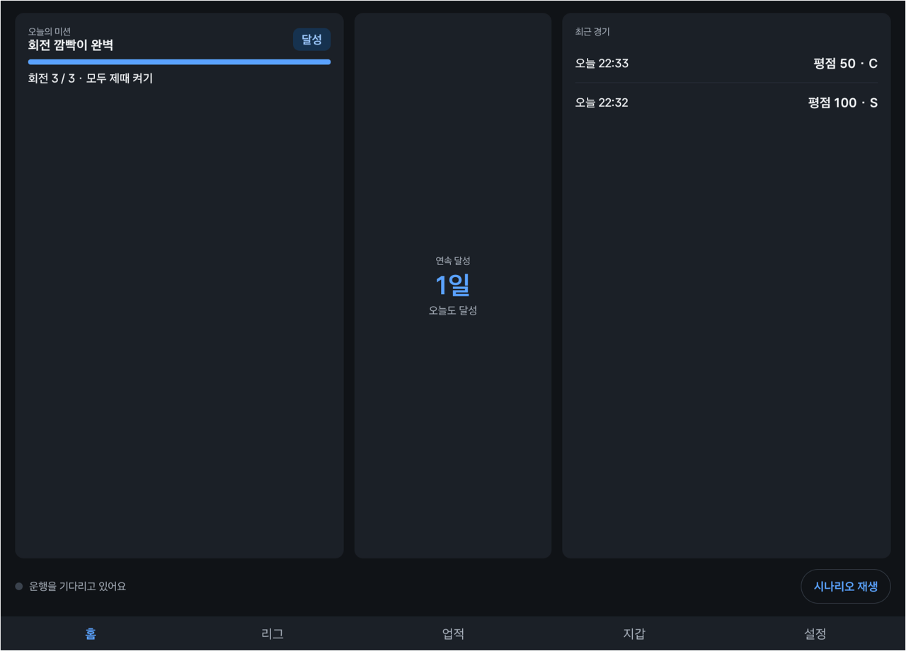 | 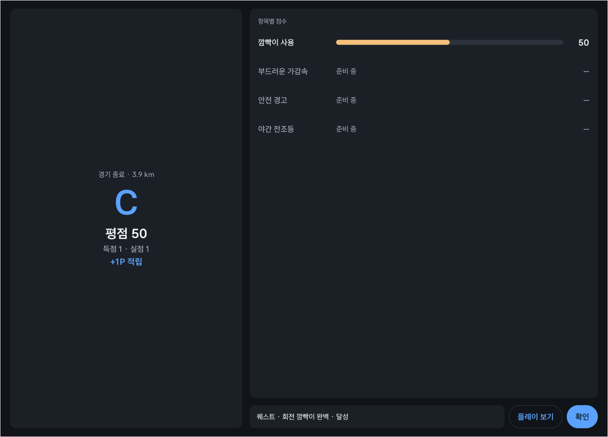 | 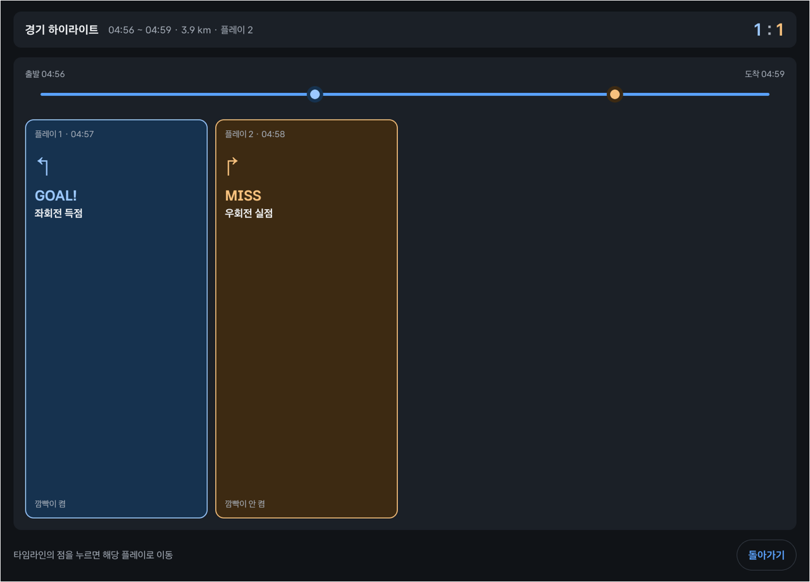 |
| **항목 상세** | **퀘스트** | **리그** |
| 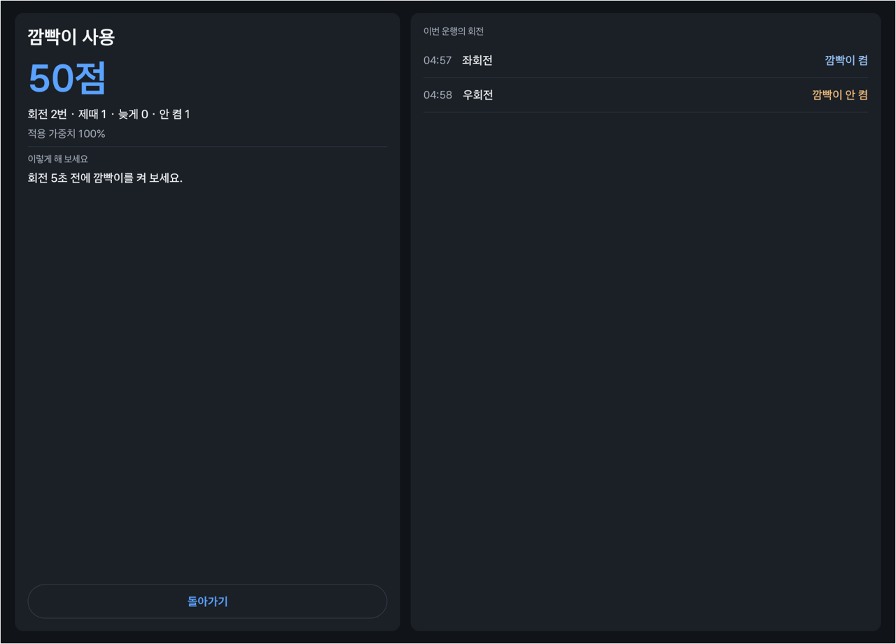 | 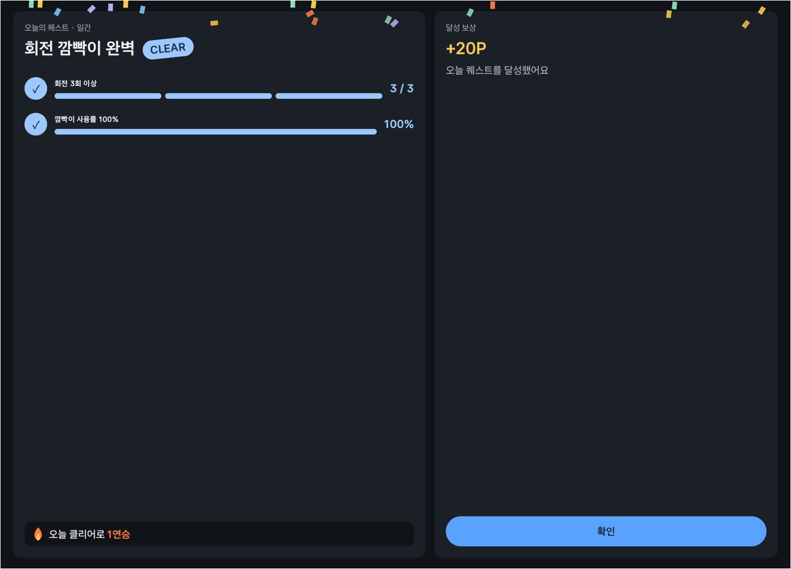 | 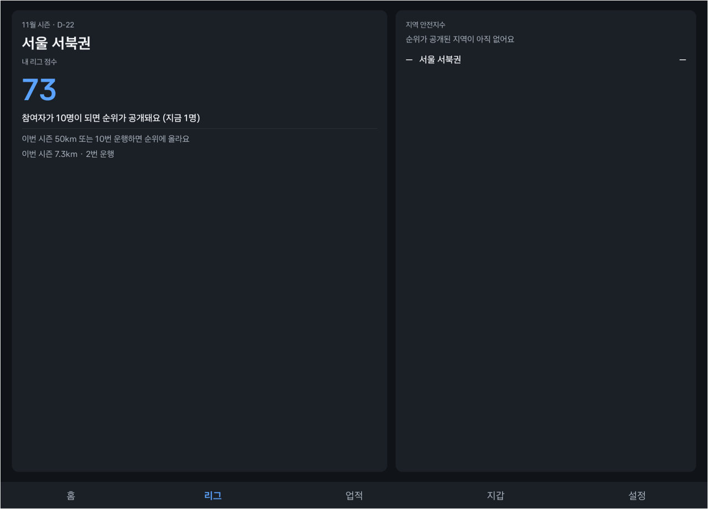 |
| **업적** | **주간 리포트** | **지갑** |
| 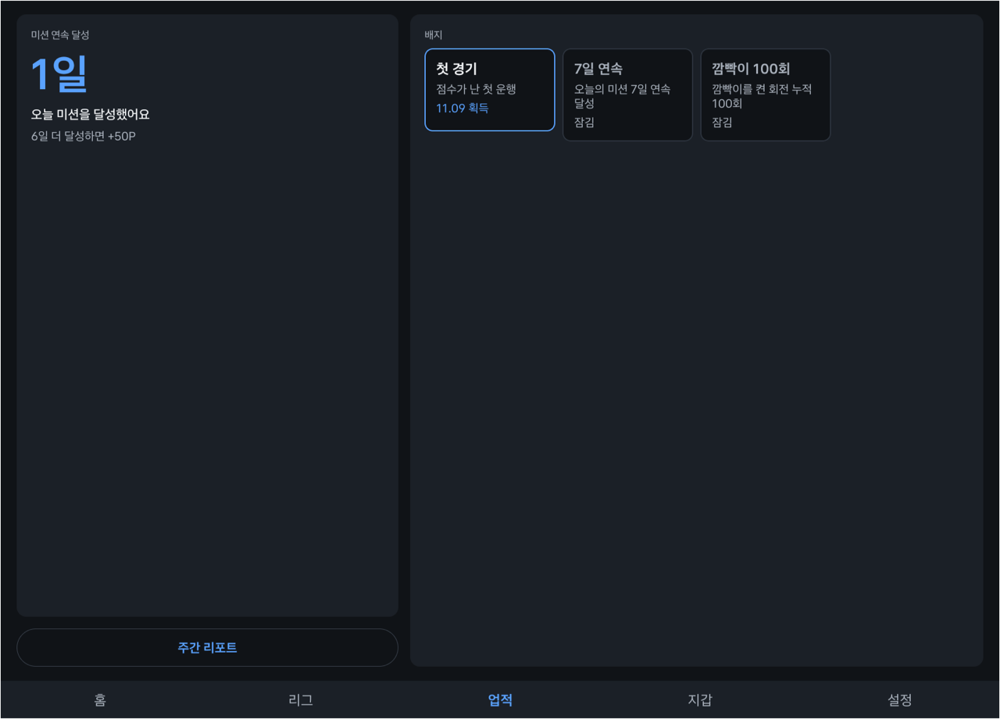 | 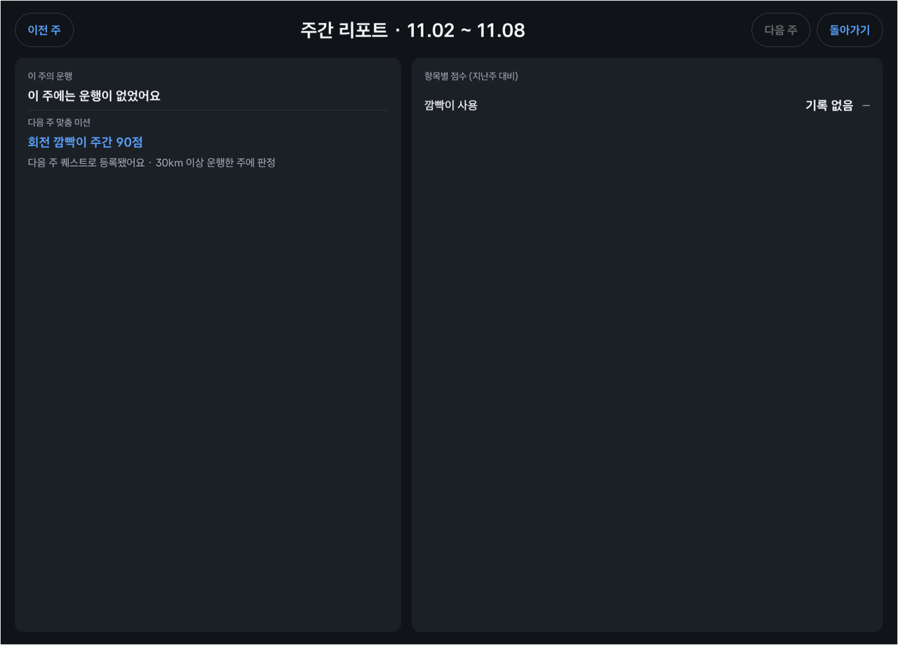 | 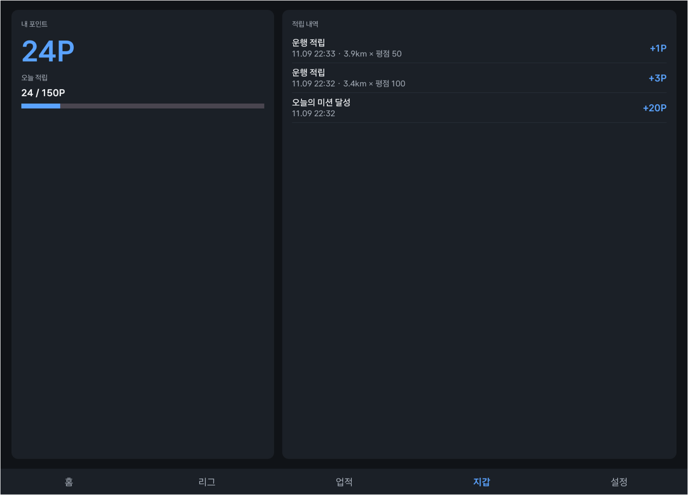 |

## 🧭 시스템 구성

**실시간성이 필요한 일은 앱**, **규칙이 바뀔 수 있는 일은 서버**가 맡습니다.

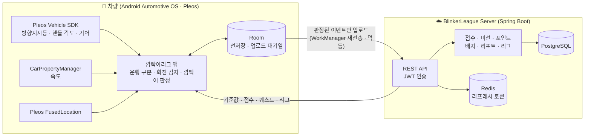

| 앱 (실시간) | 서버 (규칙) |
| --- | --- |
| 신호 · 위치 수집, 운행 구분, 회전 감지 | 점수 계산 (항목별 가중치 재분배) |
| 깜빡이 판정, 주행 중 화면 가드 | 오늘의 미션 · 연속 달성 · 배지 판정 |
| 로컬 선저장과 오프라인 재전송 | 포인트 원장 (일일 상한, 멱등 적립) |
| 정차 화면, 음성 안내 | 지역 리그 · 시즌 정산, 주간 리포트 |

판정 기준값(회전 각도, 깜빡이 시간 창, 최소 거리 등)은 코드에 고정하지 않고 서버 `GET /api/config/thresholds`에서 내려받아 교체합니다.

## 📦 저장소

### [android-app](https://github.com/BlinkerLeague/android-app) — 차량 앱

**Kotlin · Jetpack Compose · MVVM** / Android Automotive OS (minSdk 28 · targetSdk 34)

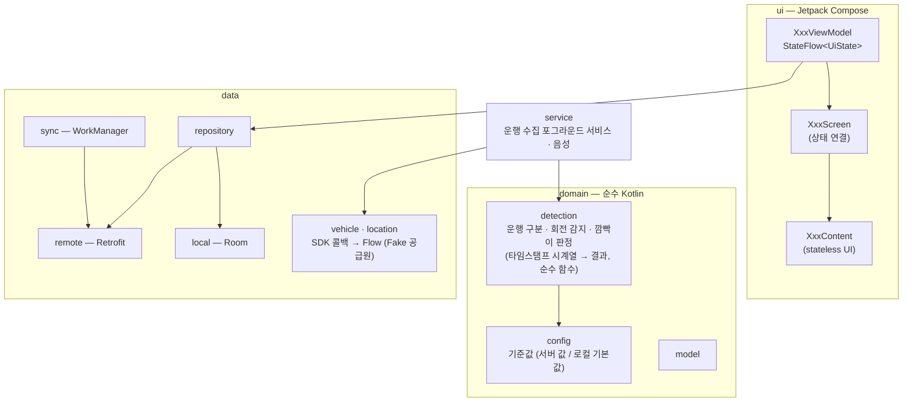

- **SDK 격리**: Vehicle SDK · Location API는 `data/vehicle`, `data/location` 안에서만 씁니다. domain과 ViewModel은 SDK 타입을 모릅니다.
- **실차 없이 테스트**: 신호 소스를 인터페이스로 두고 Fake 구현으로 위치 · 신호 시나리오를 재생합니다. 판정 엔진은 시간 함수를 직접 부르지 않는 순수 함수라 단위 테스트로 검증합니다.
- **오프라인 우선**: 판정 결과를 Room에 먼저 저장하고, 운행 · 이벤트 ID를 클라이언트 UUID로 만들어 재전송해도 중복되지 않습니다.
- **지원하지 않는 신호**는 0점이 아니라 측정에서 제외합니다.
- **보안**: 토큰은 Android Keystore 키로 암호화, 릴리스는 TLS 1.2+ · 백업 끔 · 로그 끔. SDK 조사용 코드와 권한은 `debug` 소스셋에만 둡니다.

| 구분 | 사용 기술 |
| --- | --- |
| Vehicle | Pleos Vehicle SDK 2.3.2, TextToSpeech 3.3.1, FusedLocation 1.1.3, CarPropertyManager |
| Data | Room, WorkManager, Retrofit + OkHttp + kotlinx.serialization |
| DI | 수동 DI (`AppContainer`) |
| Test | JUnit4, kotlinx-coroutines-test, Robolectric, MockWebServer |

### [server](https://github.com/BlinkerLeague/server) — 백엔드

**Java 17 · Spring Boot 3.3 · 헥사고날 아키텍처(Ports & Adapters)**

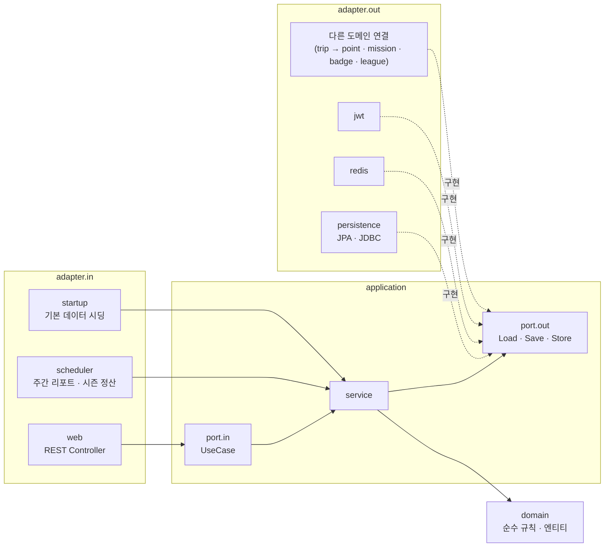

- **도메인별 패키지**: `auth` · `driver` · `threshold` · `trip` · `score` · `mission` · `point` · `badge` · `report` · `league`. 의존성은 항상 `adapter → application → domain` 방향이며 ArchUnit 테스트로 지킵니다.
- **점수 엔진**(`score`)은 Spring · JPA에 의존하지 않는 순수 도메인입니다. 측정된 항목만으로 가중치를 재분배하고, 측정하지 못한 항목은 `UNSUPPORTED` · `NOT_APPLICABLE`로 이유와 함께 남깁니다.
- **운행 업로드 한 번**이 점수 계산 → 포인트 적립 → 미션 판정 → 배지 수여 → 리그 참가로 이어집니다. 각 단계는 멱등이라 같은 `tripId`를 다시 보내도 결과가 같습니다.
- **포인트 원장**: 잔액은 저장하지 않고 원장 합계로 계산합니다. 운전자 단위 행 잠금으로 일일 상한을 동시성에서도 지킵니다.
- **규칙은 데이터로**: 기준값 · 미션 · 배지 · 리그 권역 매핑을 JSON으로 시딩하고, 기준값은 버전을 붙여 앱에 내려줍니다.

| 구분 | 사용 기술 |
| --- | --- |
| Framework | Spring Boot 3.3 (Web, Data JPA, Security, OAuth2 Resource Server, Validation) |
| Data | PostgreSQL + Flyway, Redis (리프레시 토큰 회전 · 재사용 감지) |
| API 문서 | springdoc-openapi (Swagger UI) |
| Test | JUnit5, Spring Security Test, Testcontainers(PostgreSQL), ArchUnit, H2 |

## 🛠 개발 방식

- **TDD**: 동작이 바뀌는 코드는 실패 테스트(`test:`) → 통과(`feat:` · `fix:`) → 리팩터링(`refactor:`) 커밋으로 나눕니다.
- **역할별 AI 에이전트**: Claude Code 서브에이전트를 lead → tester → developer → reviewer 역할로 나눠 작업하고, 리뷰 결과는 문서로 남깁니다.
- **API 명세 기준 협업**: 서버 Swagger 명세(`openapi.json`)를 앱과 서버가 함께 기준으로 삼고, 형식 변경 요청은 문서로 주고받습니다.
- `feature/*` 브랜치 → `develop` PR (squash merge)

## 🗓 일정

| 단계 | 시기 | 범위 |
| --- | --- | --- |
| 1차 제출 (MVP) | 2026.11.15 | 운행 자동 구분, 회전 감지 · 깜빡이 판정, 경기 결과, 오늘의 퀘스트, 음성 안내 |
| 2차 (PT) | 2026.12.02 | 가감속 · 야간 전조등 · 안전 경고 측정, 지역 리그, 포인트, 주간 리포트 고도화 |
| 이후 | — | 차로 변경 측정(ADAS SDK), 제휴 보상, 가족 · 법인 관리 |

https://github.com/user-attachments/assets/9b8171d4-a258-4950-af45-68d09c58fe7b

